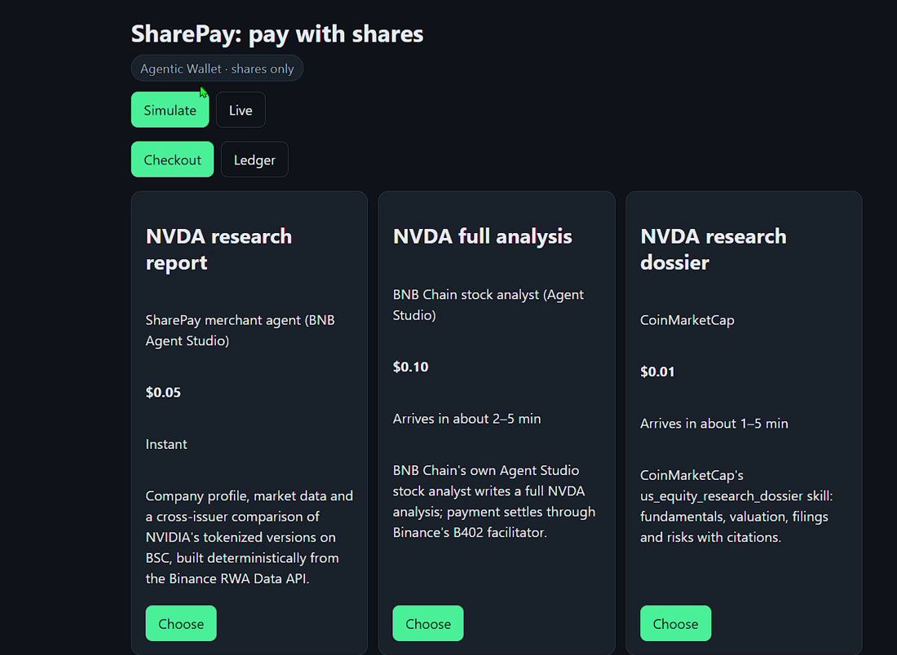
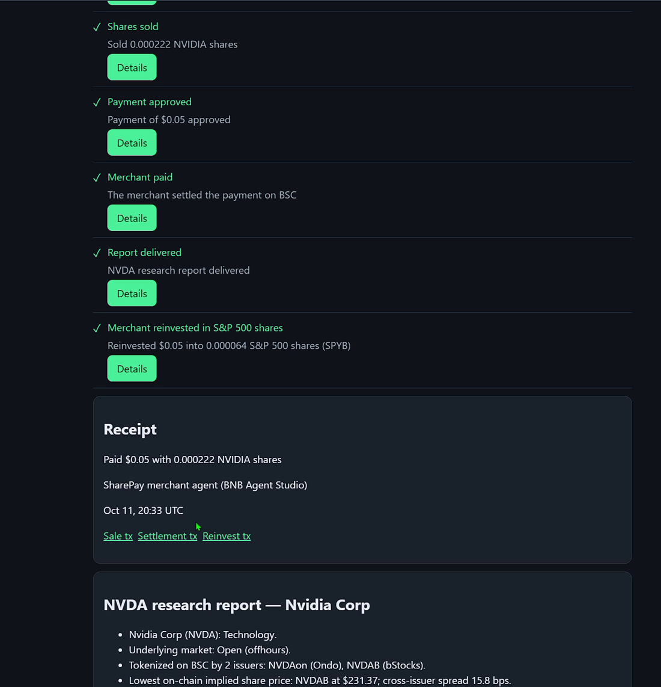

<!-- readme-schema: R1-web-app v1 -->
# SharePay

Pay for x402 services on BNB Chain with tokenized stocks: the wallet sells just enough NVIDIA shares to cover each bill.

## Demo

- **Demo video (2:51):** https://youtu.be/Ho9ZfNCqYsA
- **Live checkout:** https://sharepay-checkout.onrender.com
- **Merchant agent:** https://sharepay-merchant.onrender.com ([A2A agent card](https://sharepay-merchant.onrender.com/.well-known/agent-card.json))

| The catalog: three real x402 merchants | A live payment with NVIDIA shares, settled and reinvested |
|---|---|
|  |  |

Open the live checkout, pick **NVDA research report**, choose a stock and press **Pay**.
- **Simulate mode** (the default) runs the real price check, share quote and on-chain simulation without spending anything.
- **Live mode** needs the passcode `ThisIsVeryStrongPassword`. It runs every step on BSC mainnet with a few cents, capped at 10 payments and $1.50 per UTC day.
- The free host sleeps when idle, so the first visit can show "Starting SharePay…" for up to a minute.

### Verified live run (BSC mainnet, 11 October 2026)

The money shot, paid from the Binance Agentic Wallet: an NVDA research report bought with NVIDIA shares, then reinvested by the merchant into the S&P 500.

| Step | What happened | Transaction |
|---|---|---|
| Shares sold | The Agentic Wallet sold 0.000222 NVDAB for $0.05 of U | [`0x3f4442d4…04a3`](https://bscscan.com/tx/0x3f4442d43859bd4eef184883154b53a3d88d085215c2513b010056df830404a3) |
| Merchant paid | Our merchant verified the EIP-3009 authorization and settled it on-chain itself, with no facilitator | [`0x043cf420…9f60`](https://bscscan.com/tx/0x043cf420071fa6826fa496685ea5d78f1c683515c2dc49ef3608521396c89f60) |
| Merchant reinvested | The merchant swapped its revenue into 0.000064 SPYB (S&P 500 bStock) | [`0x3412394d…5753`](https://bscscan.com/tx/0x3412394da02886cf8e7fce3cb2a8212edb6a36d8dd20e47779248d536a805753) |

All three receipts were checked on-chain (status success). The run happened on a Sunday, while US equity markets were closed, through 24/7 AMM routes.

## What it does

AI agents and people already pay per call on BNB Chain through x402: CoinMarketCap's MCP charges about a cent, BNB Chain's own stock analyst a dime. Every payer has to park an idle stablecoin float. Every seller ends up holding stablecoins it must reinvest by hand. Meanwhile the tokenized stocks people actually save in cannot be spent at all.

SharePay is a checkout that pays those bills with shares. When a merchant answers HTTP 402, the wallet:
1. Picks which tokenized stock to sell. Halted, paused or illiquid ones are skipped, with the reason in plain English.
2. Sells just enough of it through the Binance Web3 Trading API.
3. Signs the stablecoin payment.

Our own merchant agent, built on BNB Agent Studio, settles each payment on-chain itself and reinvests what it earns into S&P 500 shares (SPYB). The money shot: buy an NVDA research report with NVIDIA shares, then watch the merchant put the proceeds into the S&P 500.

## Quickstart

```bash
git clone https://github.com/bitnormie01/sharepay.git && cd sharepay
npm ci
cp .env.example .env                      # add BINANCE_API_KEY and BINANCE_API_SECRET
npm run ops -- new-burner                 # demo wallet key goes into .env; only the address is printed
(cd sharepaymerchant/app/agent && npx bag wallet new --generate-password)
npm run build:web
npm run start:merchant:local              # terminal 1: merchant agent on http://localhost:9000
npm run start:checkout:local              # terminal 2: checkout on http://localhost:8787
```

Open http://localhost:8787. Simulate mode works with an empty wallet, and the picker explains why each stock cannot pay yet. To pay live, fund the demo wallet with a few dollars of USDT and BNB, then run `npm run ops -- buy --stock NVDAB --usdt 2.50` and `npm run ops -- approve`.

## Built at BNB Hack: Tokenized Stocks Edition

- **Event:** BNB Hack: Tokenized Stocks Edition (BNB Chain × Binance Web3 Wallet), 16 September – 11 October 2026.
- **Tracks:**
  - Main track: Tokenized Stocks Products & Agents.
  - Best Use of Agentic Wallet / Wallet Skills.
  - Best Use of BNB Agent Studio.
- **Team:** bitnormie01, a solo builder working with an AI build pipeline.
- **Built during the event:** everything in this repository, written 5–11 October 2026. That covers the checkout, the buyer engine, the merchant agent, the web app and the ops scripts.
- **No custom smart contracts.** SharePay only uses contracts already live on BSC mainnet: bStocks, Ondo, U, USD1 and the Binance aggregation router.

## How it works

**One checkout, eight steps.** The progress view shows each step with its BscScan links.

| # | Step | What happens |
|---|---|---|
| 1 | Price checked | The merchant answers HTTP 402 with an x402 v2 `exact` requirement: an EIP-3009 transfer of U (or USD1) on BSC. |
| 2 | Shares priced | The planner sizes the sale from the RWA Data API price plus a buffer, then re-quotes it through the Trading API. SWAP routes only, with a LiquidMesh fallback and a two-leg route through USDT. |
| 3 | Sale checked | The sale (or the one-time approval) is dry-run with the Transaction API `simulate`. |
| 4 | Shares sold | The demo wallet signs the swap and broadcasts it with MEV protection. The Agentic Wallet sells with `baw market-order swap` instead. |
| 5 | Payment approved | The wallet signs an EIP-3009 `transferWithAuthorization`. The Agentic Wallet uses `baw x402-payment preview/sign` instead. |
| 6 | Merchant paid | The request is replayed with `PAYMENT-SIGNATURE`. Our merchant verifies 14 rules, simulates the settlement and broadcasts it from its BNB Agent Studio wallet. Third-party merchants settle through Binance's b402 facilitator. |
| 7 | Report delivered | Delivery is instant for our report. The stock analyst runs as a polled async job. CMC runs the paid call synchronously (30–300 s, no job id) and returns one MCP reply over server-sent events. |
| 8 | Merchant reinvested in S&P 500 shares | Our merchant's sweeper swaps what it earned into SPYB and records the transaction. |

**Picker.** Every stock you hold is listed in shares (the issuer's multiplier is applied). Each one gets a plain-English reason when it cannot pay, for example:
- "Paused: stock split"
- "Market closed and no 24/7 route"
- "Below Ondo's minimum order ($5)"
- "Not enough shares"

A bStock whose market is closed but still has a 24/7 AMM route stays payable, with an amber badge. Payable stocks are ranked by open market first, then lower price impact, then larger holding.

**Merchant agent.** A BNB Agent Studio project (`sharepaymerchant/`) with an ERC-8004 identity on BSC mainnet.
- Its deterministic NVDA report has no LLM. It is built from the RWA Data API: company profile, market data, and a cross-issuer comparison of bStocks vs Ondo with on-chain implied per-share prices.
- It settles x402 payments itself, with no facilitator credentials needed.
- It reinvests revenue into SPYB.

## Tech stack

- **Language and layout:** TypeScript on Node.js 22, an npm-workspaces monorepo (`packages/core`, `buyer`, `merchant`, `checkout`, `web`, plus `sharepaymerchant/`).
- **Binance Web3 API:**
  - RWA Data: tokens, price, search, underlying profile and market.
  - Trading: quote, swap, approve-transaction.
  - Transaction: simulate, gas price, gas limit, broadcast.
  - Wallet: token balances.
  - All calls are HMAC-signed, paced and logged for the DevEx report.
- **Binance Agentic Wallet CLI (`baw` 1.10.0):** `market-order swap`, `x402-payment preview/sign`.
- **BNB Agent Studio (`@bnbagent/studio-cli` 0.0.14):** project scaffold, Studio wallet, A2A agent card, ERC-8004 registration.
- **x402 v2 `exact` scheme:** EIP-3009 with U and USD1 on BSC (chain 56).
- **Libraries:** viem, zod, Express 5, React 19, Vite 7, react-markdown, vitest and Testing Library.
- **Hosting:** two free Render web services in Singapore, defined by the Blueprint `render.yaml`.

## Run locally

| Command | What it starts |
|---|---|
| `npm run start:merchant:local` | The merchant agent (Studio runtime + SharePay routes) on port 9000 |
| `npm run start:checkout:local` | The checkout API and the built web app on port 8787 |
| `npm run dev:web` | The web app with hot reload, proxying `/api` to port 8787 |
| `npm test` | Every test (no network, no real keys) |
| `npm run smoke -- <check>` | One live smoke check: `rwa`, `third-party`, `aw-preview`, `ondo`, `merchant-live`, `erc8004`, `checkout-live` |
| `npm run ops -- <command>` | Demo-wallet operations: `new-burner`, `balances`, `buy`, `approve`, `verify-funding`, `export-seeds`, `verify-seeds` |

Environment variables (names only; values live in `.env`, which is gitignored):

| Variable | Used by | Purpose |
|---|---|---|
| `BINANCE_API_KEY`, `BINANCE_API_SECRET` | both | Binance Web3 API credentials |
| `BSC_RPC_URL` | both | BSC RPC for balances, allowances and receipts |
| `DEVEX_EVENTS_PATH` | both | Optional JSONL log of every API call |
| `WALLET_MODE` | checkout | `api-signer` (demo wallet) or `agentic-wallet` (`baw`) |
| `BUYER_PRIVATE_KEY` | checkout | The demo wallet's key; it holds only tokenized stocks and gas |
| `BAW_BIN`, `AW_PAYS_OWN_MERCHANT` | checkout | Agentic Wallet CLI path; whether the Agentic Wallet pays our own merchant |
| `MERCHANT_URL` | checkout | Where our merchant agent runs |
| `LIVE_PASSCODE`, `LIVE_DAILY_MAX_COUNT`, `LIVE_DAILY_MAX_USD` | checkout | The live-mode gate and its daily cap |
| `RECEIPTS_SEED_PATH`, `RECEIPTS_RUNTIME_PATH`, `WEB_DIST`, `PORT` | checkout | Receipt files, built web app, port |
| `MERCHANT_PUBLIC_URL`, `REPORT_PRICE_ATOMIC` | merchant | Public URL in the 402 resource; report price (0.05 U) |
| `WALLET_KEYSTORE_JSON`, `WALLET_PASSWORD` | merchant | The Studio wallet on a host (locally it lives in `sharepaymerchant/.studio/`) |
| `SWEEP_ENABLED`, `SWEEP_MIN_ATOMIC`, `SWEEP_FLOAT_ATOMIC`, `SWEEP_MAX_ATOMIC`, `SWEEP_MAX_PRICE_IMPACT`, `SWEEP_SLIPPAGE`, `SWEEP_INTERVAL_MS` | merchant | Reinvest sweeper settings |
| `ACTIVITY_PATH`, `ACTIVITY_SEED_PATH` | merchant | The merchant activity feed's files |
| `CHECKOUT_URL` | ops scripts | The deployed checkout, for smoke checks and the seed export |
| `MERCHANT_AGENT_ID` | ops scripts | The merchant's ERC-8004 agent id, for the `erc8004` smoke check |

## Contract addresses

| network | address | explorer |
|---|---|---|
| BSC mainnet · NVDAB (NVIDIA bStock) | `0x02fca66c1d1afb4e2a7884261eb00f63598a7436` | https://bscscan.com/token/0x02fca66c1d1afb4e2a7884261eb00f63598a7436 |
| BSC mainnet · TSLAB (Tesla bStock) | `0x5b1910eaad6450e50f816082aa078c41f10c292f` | https://bscscan.com/token/0x5b1910eaad6450e50f816082aa078c41f10c292f |
| BSC mainnet · AAPLB (Apple bStock) | `0x431a3bee82e2ca41e49895cbece5bb0f76a89b7a` | https://bscscan.com/token/0x431a3bee82e2ca41e49895cbece5bb0f76a89b7a |
| BSC mainnet · SPYB (S&P 500 bStock) | `0x7138b48df7d98d7e3cc221bfe7192d0a178182d8` | https://bscscan.com/token/0x7138b48df7d98d7e3cc221bfe7192d0a178182d8 |
| BSC mainnet · NVDAon (NVIDIA, Ondo) | `0xa9ee28c80f960b889dfbd1902055218cba016f75` | https://bscscan.com/token/0xa9ee28c80f960b889dfbd1902055218cba016f75 |
| BSC mainnet · TSLAon (Tesla, Ondo) | `0x2494b603319d4d9f9715c9f4496d9e0364b59d93` | https://bscscan.com/token/0x2494b603319d4d9f9715c9f4496d9e0364b59d93 |
| BSC mainnet · SPYon (S&P 500, Ondo) | `0x6a708ead771238919d85930b5a0f10454e1c331a` | https://bscscan.com/token/0x6a708ead771238919d85930b5a0f10454e1c331a |
| BSC mainnet · U (United Stables, EIP-3009) | `0xce24439f2d9c6a2289f741120fe202248b666666` | https://bscscan.com/token/0xce24439f2d9c6a2289f741120fe202248b666666 |
| BSC mainnet · USD1 (World Liberty Financial USD, EIP-3009) | `0x8d0d000ee44948fc98c9b98a4fa4921476f08b0d` | https://bscscan.com/token/0x8d0d000ee44948fc98c9b98a4fa4921476f08b0d |
| BSC mainnet · USDT | `0x55d398326f99059ff775485246999027b3197955` | https://bscscan.com/token/0x55d398326f99059ff775485246999027b3197955 |
| BSC mainnet · Binance aggregation router | `0xb44446b0c8e56988c34f7ff73ae904982b5fdda5` | https://bscscan.com/address/0xb44446b0c8e56988c34f7ff73ae904982b5fdda5 |

**SharePay's own deployment:**

| What | Address or URL | Explorer |
|---|---|---|
| Merchant agent (Render, Singapore) | https://sharepay-merchant.onrender.com | [A2A agent card](https://sharepay-merchant.onrender.com/.well-known/agent-card.json) |
| Merchant wallet (`payTo`, BNB Agent Studio) | `0x8e8B22406158c2243BC325b4E3b12b34EeB301B0` | https://bscscan.com/address/0x8e8B22406158c2243BC325b4E3b12b34EeB301B0 |
| ERC-8004 identity | Agent **370837** on the IdentityRegistry `0x8004A169FB4a3325136EB29fA0ceB6D2e539a432`, owned by the merchant wallet | [Registration tx](https://bscscan.com/tx/0x9db4d9c5ca745e9463301d2fbb99b9bf0c4cd866dfc9ffc49a16dff8e8a4910d) |
| Demo wallet (hosted live mode, `api-signer`) | `0xB89a65d5b5bf0e99E8A3ff74398470e4E153951f` | https://bscscan.com/address/0xB89a65d5b5bf0e99E8A3ff74398470e4E153951f |
| Binance Agentic Wallet (the money shot) | `0x72905bF92D6a74414deC2236C5b76e8E7372950f` | https://bscscan.com/address/0x72905bF92D6a74414deC2236C5b76e8E7372950f |
| Checkout (Render, Singapore) | https://sharepay-checkout.onrender.com | `/api/health?deep=1` checks Binance, the RPC and the merchant |

## Roadmap

**Known limitations:**
- RFQ routes are never executed: sub-dollar payments only use SWAP routes.
- Ondo's minimum order size greys Ondo out for cent-sized payments. It stays visible with the reason.
- The hosted demo runs one live checkout at a time, under a daily cap.
- Receipts outlive a restart of the free host only through the committed, on-chain-verified seed file.
- CoinMarketCap's dossier: in our live tests the payment settled, but the reply stream was cut off before the report arrived (two settled one-cent payments, no report).

**Next steps:**
- Pay any x402 merchant by URL.
- Let the merchant pick its reinvestment basket.
- Package the buyer engine as an MCP server, so any agent can pay with shares.

## License

MIT. See [LICENSE](LICENSE).
